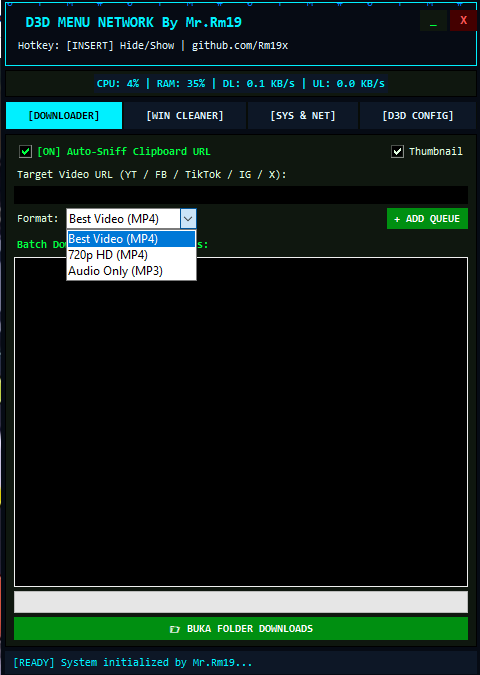
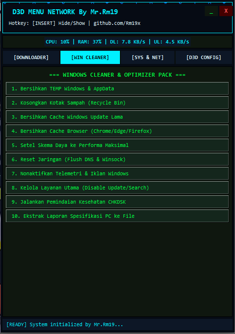
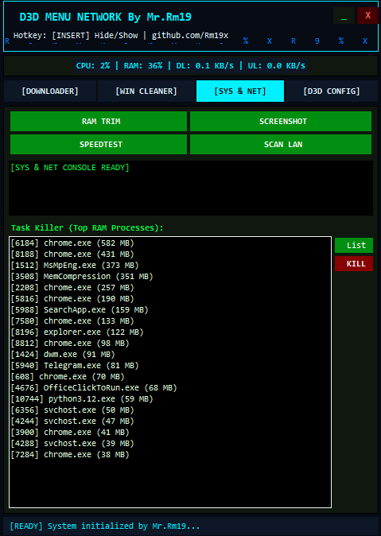

#  DEMN (D3D MENU NETWORK)
### **Advanced Python-Based D3D Overlay, System Optimizer & Network Utility Suite**

---

**DEMN** (D3D MENU NETWORK)  perangkat lunak *overlay* desktop dan  sistem *all-in-one* kelas atas yang dikembangkan menggunakan Python. Dengan memadukan estetika siber bergaya D3D yang imersif serta perangkat *backend* yang tangguh, DEMN menggabungkan berbagai fungsi—seperti pembersihan sistem Windows yang efektif, pemantauan memori latar belakang secara *real-time*, pengunduhan media lintas platform, hingga diagnostik jaringan—ke dalam satu menu melayang tanpa bingkai (*frameless*).

---

  
  
  

